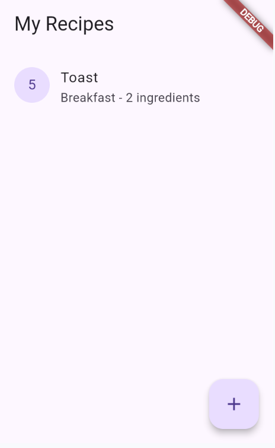
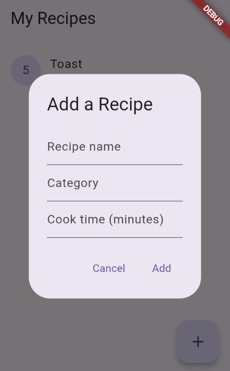
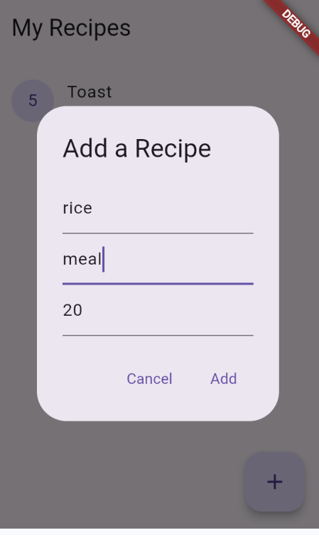
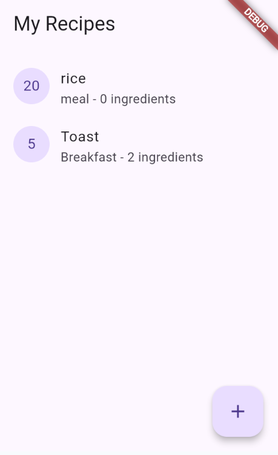
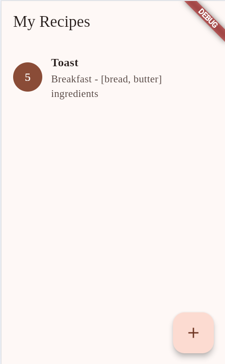

# Recipe List

Recipe List is a simple app to store recipes. It stores name, category, and cook time.

## Who is this for?

This is for someone who wants to simply store recipes.

## What it does

Tap the + button to add a recipe.

Type in the name, category, and cook time.

The new recipe shows up as a card with the cook time and ingredient count. Tap to favorite, long-press to delete.

## Why it's useful

To store recipes real quick so you remember them.

## Theme and Custom Font

I added an orange theme using `ColorScheme.fromSeed` and the Tinos font from Google Fonts.

